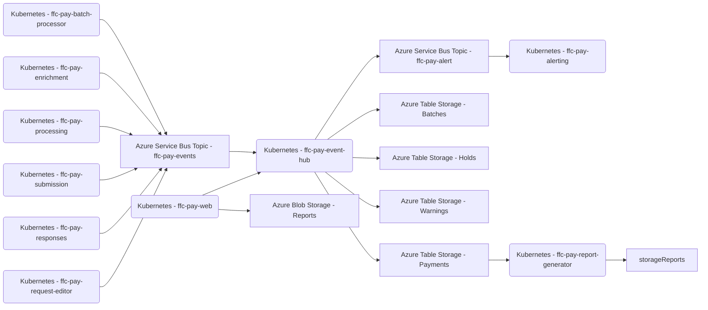
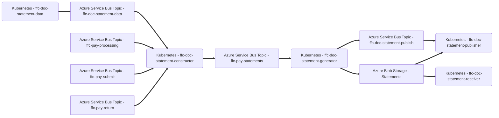

# Payment Hub Core

Local development support for orchestrating all Payment Hub microservices.

## Prerequisites

Ensure you have satisfied the prerequisites of all individual repositories.

## Repositories

### Payments

#### Processing

- [ffc-pay-gateway](https://github.com/defra/ffc-pay-gateway)
- [ffc-pay-batch-verifier](https://github.com/defra/ffc-pay-batch-verifier)
- [ffc-pay-batch-processor](https://github.com/defra/ffc-pay-batch-processor)
- [ffc-pay-enrichment](https://github.com/defra/ffc-pay-enrichment)
- [ffc-pay-processing](https://github.com/defra/ffc-pay-processing)
- [ffc-pay-submission](https://github.com/defra/ffc-pay-submission)
- [ffc-pay-tracking](https://github.com/defra/ffc-pay-tracking)
- [ffc-pay-responses](https://github.com/defra/ffc-pay-responses)
- [ffc-pay-request-editor](https://github.com/defra/ffc-pay-request-editor)
- [ffc-pay-web](https://github.com/defra/ffc-pay-web)
- [ffc-pay-file-publisher](https://github.com/defra/ffc-pay-file-publisher)
- [ffc-pay-file-receiver](https://github.com/defra/ffc-pay-file-receiver)
- [ffc-pay-injection](https://github.com/defra/ffc-pay-injection)
- [ffc-pay-xb](https://github.com/defra/ffc-pay-xb)
- [ffc-pay-dps](https://github.com/defra/ffc-pay-dps)
- [ffc-pay-demographics](https://github.com/defra/ffc-pay-demographics)

#### Monitoring

- [ffc-pay-event-hub](https://github.com/defra/ffc-pay-event-hub)
- [ffc-pay-alerting](https://github.com/defra/ffc-pay-alerting)
- [ffc-pay-report-generator](https://github.com/defra/ffc-pay-report-generator)

### Statements

- [ffc-doc-statement-data](https://github.com/defra/ffc-doc-statement-data)
- [ffc-doc-statement-constructor](https://github.com/defra/ffc-doc-statement-constructor)
- [ffc-doc-statement-generator](https://github.com/defra/ffc-doc-statement-generator)
- [ffc-doc-statement-publisher](https://github.com/defra/ffc-doc-statement-publisher)
- [ffc-doc-statement-receiver](https://github.com/defra/ffc-doc-statement-receiver)

## Sequence

### Payments



```mermaid
flowchart LR
ffc-pay-gateway(Kubernetes - ffc-pay-gateway)
ffc-pay-batch-verifier(Kubernetes - ffc-pay-batch-verifier)
ffc-pay-batch-processor(Kubernetes - ffc-pay-batch-processor)
ffc-pay-enrichment(Kubernetes - ffc-pay-enrichment)
ffc-pay-processing(Kubernetes - ffc-pay-processing)
ffc-pay-submission(Kubernetes - ffc-pay-submission)
ffc-pay-responses(Kubernetes - ffc-pay-responses)
ffc-pay-request-editor(Kubernetes - ffc-pay-request-editor)
ffc-pay-web(Kubernetes - ffc-pay-web)
ffc-pay-file-publisher(Kubernetes - ffc-pay-file-publisher)
ffc-pay-file-receiver(Kubernetes - ffc-pay-file-receiver)
ffc-pay-injection(Kubernetes - ffc-pay-injection)

storageBatch[Azure Blob Storage - Batch]
storageManual[Azure Blob Storage - Manual]
storageDAX[Azure Blob Storage - DAX]

topicRequest[Azure Service Bus Topic - ffc-pay-request]
topicResponse[Azure Service Bus Topic - ffc-pay-request-response]
topicProcessing[Azure Service Bus Topic - ffc-pay-processing]
topicSubmit[Azure Service Bus Topic - ffc-pay-submit]
topicFileSend[Azure Service Bus Topic - ffc-pay-file-send]
topicFileConsume[Azure Service Bus Topic - ffc-pay-file-consume]
topicReturn[Azure Service Bus Topic - ffc-pay-return]
topicAck[Azure Service Bus Topic - ffc-pay-acknowledgement]
topicDebt[Azure Service Bus Topic - ffc-pay-debt-data]
topicDebtResponse[Azure Service Bus Topic - ffc-pay-debt-data-response]
topicLedger[Azure Service Bus Topic - ffc-pay-manual-ledger-check]
topicLedgerResponse[Azure Service Bus Topic - ffc-pay-manual-ledger-response]
topicEvent[Azure Service Bus Topic - ffc-pay-event]

ffc-pay-gateway ==> storageBatch
storageBatch ==> ffc-pay-batch-verifier
storageBatch ==> ffc-pay-batch-processor
ffc-pay-batch-processor ==> topicRequest
topicRequest ==> ffc-pay-enrichment
ffc-pay-enrichment ==> topicResponse
ffc-pay-enrichment ==> topicProcessing
topicProcessing ==> ffc-pay-processing
ffc-pay-processing ==> topicSubmit
topicSubmit ==> ffc-pay-submission
ffc-pay-submission ==> storageDAX
ffc-pay-submission ==> topicFileSend
topicFileSend ==> ffc-pay-file-sender
topicFileSend ==> ffc-pay-file-publisher
storageDAX ==> ffc-pay-file-publisher
storageDAX ==> ffc-pay-gateway
storageManual ==> ffc-pay-injection
ffc-pay-injection ==> topicRequest

topicFileConsume ==> ffc-pay-file-receiver
ffc-pay-file-consumer ==> storageDAX
storageDAX ==> ffc-pay-responses
ffc-pay-responses ==> topicAck
ffc-pay-responses ==> topicReturn
topicAck ==> ffc-pay-processing
topicReturn ==> ffc-pay-processing

ffc-pay-processing ==> topicDebt
ffc-pay-processing ==> topicLedger
topicDebt ==> ffc-pay-request-editor
topicLedger ==> ffc-pay-request-editor
ffc-pay-request-editor ==> topicDebtResponse
ffc-pay-request-editor ==> topicLedgerResponse
topicDebtResponse ==> ffc-pay-processing
topicLedgerResponse ==> ffc-pay-processing

ffc-pay-web --> ffc-pay-processing
ffc-pay-web --> storageReport
ffc-pay-web --> storageProjection
```

### Monitoring



### Statements



## Scripts

### Clone

Clone all repositories from GitHub. Repositories will cloned in the parent directory of this repository.

[`./clone`](clone)

### Update

Switch to `main` branch in every repository and pull latest changes with `git pull`.

[`./update`](update)

### Build

Build/rebuild Docker container for all microservices.

[`./build`](build)

### Setup

Backs up your existing `~/.bashrc`, copies in the template, injects your email, suffix, and fetches Azure Key Vault secrets.  
Saves your Key Vault name, email and suffix in `~/.bashrc_setup.conf` so you only enter them once.

Also asks for your personal SonarCloud token, used by the [SonarCloud Quality Gate check](#sonarcloud-quality-gate-check). Leave it blank to skip, and you'll be asked again next time.

[`./setup`](setup)

#### Optional arguments

- `-r` - removed saved configuration `.bashrc_setup.conf`

### Start

Run all payment, document and PDS services. PDS is used by both payments and documents, so it always runs.

Runs `Seed` script when payment services are started, if `ffc-pay-scripts` repository is cloned.

[`./start`](start)

#### Optional arguments

- `-p` - only payment services, plus PDS
- `-d` - only document services, plus PDS

### Stop

Run all payment services.

[`./stop`](stop)

#### Optional arguments

Any valid `docker compose down` argument.

### Seed

Seed customer mapping data from private repository to `ffc-pay-enrichment` if `ffc-pay-scripts` repository is cloned.

[`./seed`](seed)

### Open

Open all payment services in Visual Studio Code.

[`./open`](open)

#### Optional arguments

- `-f` - include Azure Functions
- `-s` - include Statement services
- `-S` - only statement services

### Latest versions

List latest GitHub release version for each microservice.

[`./latest-versions`](latest-versions)

### Environment versions

List current environment version for each microservice hosted in Kubernetes.

[`./environment-versions`](environment-versions)

#### Options

- `-c | --cluster` - Kubernetes cluster context name
- `-n | --namespace` - Kubernetes namespace

### Resource quota

Determine the Kubernetes resource usage for a namespace based on all microservices running at maximum capacity and scaling.

[`./resource-quota`](resource-quota)

## SonarCloud Quality Gate check

Every FCP Node service can show its SonarCloud Quality Gate result for your branch locally, before you push. With `SONAR_TOKEN` set, `scripts/test` prints the result once the tests pass. Without it, `scripts/test` runs as before and ends with a note that the check isn't set up.

The check only runs in branch mode, so nothing is posted to GitHub or your pull request. It uses the coverage your tests just produced (`test-output/lcov.info`), so the figures match SonarCloud for the same branch.

### Getting a token

1. Sign in to [SonarCloud](https://sonarcloud.io) with your GitHub account.
2. Make sure you're a member of the [defra organisation](https://sonarcloud.io/organizations/defra). If not, ask a lead to add you. Without it the check fails with a 403.
3. Generate a token at [My Account > Security](https://sonarcloud.io/account/security).
4. Run [`./setup`](setup) and paste the token when asked. It checks the token works and that you're in the `defra` organisation, then writes `export SONAR_TOKEN=...` into `~/.bashrc`.
5. Run `source ~/.bashrc`.

To change your token later, run `./setup -r` and then `./setup`. Don't add `SONAR_TOKEN` to `~/.bashrc` by hand, because `./setup` replaces that file each time it runs.

### Usage

Run these from any service repository.

| Command | What it does |
| --- | --- |
| `scripts/test` | Runs the tests, then the check if `SONAR_TOKEN` is set |
| `scripts/sonar` | Runs the check, rerunning the tests only if the code has changed since they last passed |
| `scripts/sonar --files` | Also lists files with uncovered new code, worst first |
| `scripts/sonar --run-tests` | Always reruns the tests first |
| `scripts/sonar --skip-tests` | Reuses `test-output/lcov.info` without running the tests |
| `npm run test:sonar` | The same as `scripts/sonar`. Pass options after `--`, e.g. `npm run test:sonar -- --files` |
| `scripts/sonar --help` | Shows all options |

A failed Quality Gate exits with `1`, so `scripts/test` also fails even if every test passed. Set `SONAR_SKIP_AUTOCHECK=true` to run `scripts/test` without the check, for example when offline. Set `NO_COLOR=1` for plain output.

### How it works

The check itself is `scripts/sonar-check.js` in [ffc-shared-actions](https://github.com/DEFRA/ffc-shared-actions). Each service only has a `scripts/sonar` wrapper, a hook at the end of `scripts/test` and a `test:sonar` npm script. The wrapper downloads the latest check every time it runs, so fixes are made once in ffc-shared-actions. No per-service config is needed: the project key is the `name` in `package.json` and the branch comes from git.

To try a change to the check before it's merged, point the wrapper at your branch:

```sh
SONAR_CHECK_URL=https://raw.githubusercontent.com/DEFRA/ffc-shared-actions/<branch>/scripts/sonar-check.js scripts/sonar
```

### Troubleshooting

- `SonarCloud rejected SONAR_TOKEN (401)` - the token is wrong, expired or revoked. Generate a new one and run `./setup -r` then `./setup`.
- `Your SonarCloud account can't access this project (403)` - you're not in the `defra` organisation.
- `Failed to fetch the shared Sonar check` - GitHub couldn't be reached. Check your connection, or set `SONAR_SKIP_AUTOCHECK=true`.
- `Timed out waiting for SonarCloud to process the analysis` - SonarCloud is busy. Retry with `scripts/sonar --skip-tests`.
- `SONAR_TOKEN is not set` straight after running `./setup` - your current terminal hasn't loaded the new `~/.bashrc`. Open a new terminal or run `source ~/.bashrc`.
- The check still runs after you remove the token - the token is still exported in your current terminal. Run `unset SONAR_TOKEN` or open a new terminal.
- Coverage differs from the SonarCloud UI - run `scripts/sonar --run-tests` and refresh the UI.

## Dev tools

Helpers for making the same git change across many repositories, e.g. a dependency upgrade in every service. They act on the same repositories as [`./update`](update) and need `bash`. Repositories that aren't cloned are ignored.

Each script shows what it is about to do per repository and asks before making changes or pushing. Pass `-y` to skip the prompts. Run any script with `-h` for full usage.

### Create branch

Create a branch from the latest `origin/main` in every repository, or only those passed with `-r`. Repositories that already have the branch, locally or on origin, are skipped. Uncommitted changes are carried over to the new branch.

[`./devtools/create-branch`](devtools/create-branch)

```sh
./devtools/create-branch -b DOC-1234 -r "ffc-pay-processing ffc-pay-submission" -p
```

#### Options

- `-b` - branch to create (required)
- `-s` - branch to create from (default `main`)
- `-r` - only these repositories, space separated in one quoted argument, e.g. `-r "ffc-pay-web ffc-pay-tracking"`
- `-p` - push the new branch and set upstream
- `-y` - skip confirmation prompts

### Switch

Switch every repository that has a branch, locally or on origin, onto that branch, e.g. back to `main` or onto a teammate's branch. Repositories without the branch are left alone, unless `-m` is passed to switch them to `main` and fast-forward it. Repositories with uncommitted changes are skipped, unless `-s` is passed to stash them. Stashed changes are restored the next time you switch back to that branch with `-s`. Lists every switch and asks once before making them.

[`./devtools/switch`](devtools/switch)

```sh
./devtools/switch -b main -s -u
./devtools/switch -b DOC-1234 -s -u -m
```

#### Options

- `-b` - branch to switch to (required)
- `-r` - only these repositories, space separated in one quoted argument, e.g. `-r "ffc-pay-web ffc-pay-tracking"`
- `-s` - stash uncommitted changes before switching, and restore any changes stashed on the target branch
- `-u` - fast-forward the branch from origin, including repositories already on it
- `-m` - switch repositories without the branch to `main` instead, and fast-forward `main`
- `-y` - skip confirmation prompts

### Commit

Commit and push changes in every repository currently on a branch, using the same message. Shows each repository's diff and asks before committing, then prints a summary of committed, skipped and failed repositories.

[`./devtools/commit`](devtools/commit)

```sh
./devtools/commit -b DOC-1234 -c "DOC-1234: relax npm audit threshold" -f "azure-pipelines.yml .snyk"
```

#### Options

- `-b` - only include repositories on this branch (required)
- `-c` - commit message (required)
- `-f` - only commit these paths, space separated. Without it, all changes including new files are committed
- `-y` - skip confirmation prompts

### Create PR

Open a pull request into `main` in every repository currently on a branch, using the [GitHub CLI](https://cli.github.com) (`gh auth login` first). Repositories where the branch isn't pushed, has no new commits or already has an open pull request are skipped. Prints the links when done.

[`./devtools/create-pr`](devtools/create-pr)

```sh
./devtools/create-pr -b DOC-1234 -t "DOC-1234: migrate to Knex" -d "See DOC-1234" -D
```

#### Options

- `-b` - only include repositories on this branch (required)
- `-t` - pull request title (required)
- `-d` - pull request description
- `-s` - branch to merge into (default `main`)
- `-D` - create as draft
- `-y` - skip confirmation prompts

### Merge main

Pull `main` and merge it into the branch in every repository currently on that branch. Repositories with uncommitted changes are skipped. Conflicts are reported per repository without stopping the run, and the merge is left in progress for you to resolve.

[`./devtools/merge-main`](devtools/merge-main)

```sh
./devtools/merge-main -b DOC-1234 -p
```

#### Options

- `-b` - only include repositories on this branch (required)
- `-s` - branch to merge in (default `main`)
- `-a` - abort conflicting merges instead of leaving them in progress
- `-p` - push the branch after a successful merge
- `-y` - skip confirmation prompts

### Sync

Like [`./update`](update), but pulls the latest changes into whatever branch each repository is on instead of switching to `main`. Branches are only fast-forwarded. Repositories that have diverged from origin, would clash with uncommitted changes or have no upstream are reported and left alone. Nothing is pushed.

[`./devtools/sync`](devtools/sync)

```sh
./devtools/sync -b DOC-1234 -m
```

#### Options

- `-b` - only include repositories on this branch (default all repositories)
- `-m` - also fast-forward local `main` without checking it out

### Run

Run the same shell command in every repository currently on a branch, e.g. `npm i && npm audit fix`. Asks once before running, keeps going if a repository fails and prints a summary. Nothing is committed - use [`./devtools/commit`](devtools/commit) afterwards.

[`./devtools/run`](devtools/run)

```sh
./devtools/run -b DOC-1234 -x "npm i && npm audit fix"
```

#### Options

- `-b` - only include repositories on this branch (required)
- `-x` - shell command to run in each repository (required)
- `-y` - skip confirmation prompts

Except for Create branch and Switch, scripts that take `-b` skip repositories not on that branch. Repositories that have the branch but are on another one get a warning.

## Resources

### Payments

A set of test datasets and scripts to support testing of payments.

### Statements

A set of test datasets and scripts to support testing of statements.

Instructions for use can be read [here](resources/testing/statements/Instructions.md).
