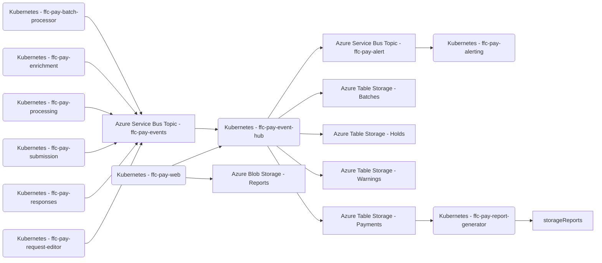
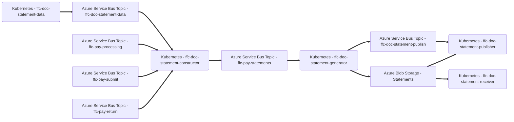

# Payment Hub Core

Local development support for orchestrating all Payment Hub microservices.

## Prerequisites

Ensure you have satisfied the prerequisites of all individual repositories.

## Repositories

### Payments

#### Processing

- [ffc-pay-gateway](https://github.com/defra/ffc-pay-gateway)
- [ffc-pay-batch-verifier](https://github.com/defra/ffc-pay-batch-verifier)
- [ffc-pay-batch-processor](https://github.com/defra/ffc-pay-batch-processor)
- [ffc-pay-enrichment](https://github.com/defra/ffc-pay-enrichment)
- [ffc-pay-processing](https://github.com/defra/ffc-pay-processing)
- [ffc-pay-submission](https://github.com/defra/ffc-pay-submission)
- [ffc-pay-tracking](https://github.com/defra/ffc-pay-tracking)
- [ffc-pay-responses](https://github.com/defra/ffc-pay-responses)
- [ffc-pay-request-editor](https://github.com/defra/ffc-pay-request-editor)
- [ffc-pay-web](https://github.com/defra/ffc-pay-web)
- [ffc-pay-file-publisher](https://github.com/defra/ffc-pay-file-publisher)
- [ffc-pay-file-receiver](https://github.com/defra/ffc-pay-file-receiver)
- [ffc-pay-injection](https://github.com/defra/ffc-pay-injection)
- [ffc-pay-xb](https://github.com/defra/ffc-pay-xb)
- [ffc-pay-dps](https://github.com/defra/ffc-pay-dps)
- [ffc-pay-demographics](https://github.com/defra/ffc-pay-demographics)

#### Monitoring

- [ffc-pay-event-hub](https://github.com/defra/ffc-pay-event-hub)
- [ffc-pay-alerting](https://github.com/defra/ffc-pay-alerting)
- [ffc-pay-report-generator](https://github.com/defra/ffc-pay-report-generator)

### Statements

- [ffc-doc-statement-data](https://github.com/defra/ffc-doc-statement-data)
- [ffc-doc-statement-constructor](https://github.com/defra/ffc-doc-statement-constructor)
- [ffc-doc-statement-generator](https://github.com/defra/ffc-doc-statement-generator)
- [ffc-doc-statement-publisher](https://github.com/defra/ffc-doc-statement-publisher)
- [ffc-doc-statement-receiver](https://github.com/defra/ffc-doc-statement-receiver)

## Sequence

### Payments



```mermaid
flowchart LR
ffc-pay-gateway(Kubernetes - ffc-pay-gateway)
ffc-pay-batch-verifier(Kubernetes - ffc-pay-batch-verifier)
ffc-pay-batch-processor(Kubernetes - ffc-pay-batch-processor)
ffc-pay-enrichment(Kubernetes - ffc-pay-enrichment)
ffc-pay-processing(Kubernetes - ffc-pay-processing)
ffc-pay-submission(Kubernetes - ffc-pay-submission)
ffc-pay-responses(Kubernetes - ffc-pay-responses)
ffc-pay-request-editor(Kubernetes - ffc-pay-request-editor)
ffc-pay-web(Kubernetes - ffc-pay-web)
ffc-pay-file-publisher(Kubernetes - ffc-pay-file-publisher)
ffc-pay-file-receiver(Kubernetes - ffc-pay-file-receiver)
ffc-pay-injection(Kubernetes - ffc-pay-injection)

storageBatch[Azure Blob Storage - Batch]
storageManual[Azure Blob Storage - Manual]
storageDAX[Azure Blob Storage - DAX]

topicRequest[Azure Service Bus Topic - ffc-pay-request]
topicResponse[Azure Service Bus Topic - ffc-pay-request-response]
topicProcessing[Azure Service Bus Topic - ffc-pay-processing]
topicSubmit[Azure Service Bus Topic - ffc-pay-submit]
topicFileSend[Azure Service Bus Topic - ffc-pay-file-send]
topicFileConsume[Azure Service Bus Topic - ffc-pay-file-consume]
topicReturn[Azure Service Bus Topic - ffc-pay-return]
topicAck[Azure Service Bus Topic - ffc-pay-acknowledgement]
topicDebt[Azure Service Bus Topic - ffc-pay-debt-data]
topicDebtResponse[Azure Service Bus Topic - ffc-pay-debt-data-response]
topicLedger[Azure Service Bus Topic - ffc-pay-manual-ledger-check]
topicLedgerResponse[Azure Service Bus Topic - ffc-pay-manual-ledger-response]
topicEvent[Azure Service Bus Topic - ffc-pay-event]

ffc-pay-gateway ==> storageBatch
storageBatch ==> ffc-pay-batch-verifier
storageBatch ==> ffc-pay-batch-processor
ffc-pay-batch-processor ==> topicRequest
topicRequest ==> ffc-pay-enrichment
ffc-pay-enrichment ==> topicResponse
ffc-pay-enrichment ==> topicProcessing
topicProcessing ==> ffc-pay-processing
ffc-pay-processing ==> topicSubmit
topicSubmit ==> ffc-pay-submission
ffc-pay-submission ==> storageDAX
ffc-pay-submission ==> topicFileSend
topicFileSend ==> ffc-pay-file-sender
topicFileSend ==> ffc-pay-file-publisher
storageDAX ==> ffc-pay-file-publisher
storageDAX ==> ffc-pay-gateway
storageManual ==> ffc-pay-injection
ffc-pay-injection ==> topicRequest

topicFileConsume ==> ffc-pay-file-receiver
ffc-pay-file-consumer ==> storageDAX
storageDAX ==> ffc-pay-responses
ffc-pay-responses ==> topicAck
ffc-pay-responses ==> topicReturn
topicAck ==> ffc-pay-processing
topicReturn ==> ffc-pay-processing

ffc-pay-processing ==> topicDebt
ffc-pay-processing ==> topicLedger
topicDebt ==> ffc-pay-request-editor
topicLedger ==> ffc-pay-request-editor
ffc-pay-request-editor ==> topicDebtResponse
ffc-pay-request-editor ==> topicLedgerResponse
topicDebtResponse ==> ffc-pay-processing
topicLedgerResponse ==> ffc-pay-processing

ffc-pay-web --> ffc-pay-processing
ffc-pay-web --> storageReport
ffc-pay-web --> storageProjection
```

### Monitoring



### Statements



## Scripts

### Clone

Clone all repositories from GitHub. Repositories will cloned in the parent directory of this repository.

[`./clone`](clone)

### Update

Switch to `main` branch in every repository and pull latest changes with `git pull`.

[`./update`](update)

### Build

Build/rebuild Docker container for all microservices.

[`./build`](build)

### Setup

Backs up your existing `~/.bashrc`, copies in the template, injects your email, suffix, and fetches Azure Key Vault secrets.  
Saves your Key Vault name, email and suffix in `~/.bashrc_setup.conf` so you only enter them once.

[`./setup`](setup)

#### Optional arguments

- `-r` - removed saved configuration `.bashrc_setup.conf`

### Start

Run all payment services.

Runs `Seed` script if `ffc-pay-scripts` repository is cloned.

[`./start`](start)

#### Optional arguments

- `-f` - include Azure Functions
- `-s` - include Statement services
- `-S` - only statement services

### Stop

Run all payment services.

[`./stop`](stop)

#### Optional arguments

Any valid `docker compose down` argument.

### Seed

Seed customer mapping data from private repository to `ffc-pay-enrichment` if `ffc-pay-scripts` repository is cloned.

[`./seed`](seed)

### Open

Open all payment services in Visual Studio Code.

[`./open`](open)

#### Optional arguments

- `-f` - include Azure Functions
- `-s` - include Statement services
- `-S` - only statement services

### Latest versions

List latest GitHub release version for each microservice.

[`./latest-versions`](latest-versions)

### Environment versions

List current environment version for each microservice hosted in Kubernetes.

[`./environment-versions`](environment-versions)

#### Options

- `-c | --cluster` - Kubernetes cluster context name
- `-n | --namespace` - Kubernetes namespace

### Resource quota

Determine the Kubernetes resource usage for a namespace based on all microservices running at maximum capacity and scaling.

[`./resource-quota`](resource-quota)

## Dev tools

Helpers for making the same git change across many repositories, e.g. a dependency upgrade in every service. They act on the same repositories as [`./update`](update), plus `ffc-pds-web` and `fcp-pds-data-retention`, and need `bash`. Repositories that aren't cloned are ignored.

Every script takes `-g` to limit it to one group of repositories: `payments` (including `ffc-pay-core` and `ffc-pay-scripts`), `documents`, `pds` or `all` (default).

Each script shows what it is about to do per repository and asks before making changes or pushing. Pass `-y` to skip the prompts. Run any script with `-h` for full usage.

### Create branch

Create a branch from the latest `origin/main` in every repository, or only those passed with `-r`. Repositories that already have the branch, locally or on origin, are skipped. Uncommitted changes are carried over to the new branch.

[`./devtools/create-branch`](devtools/create-branch)

```sh
./devtools/create-branch -b DOC-1234 -r "ffc-pay-processing ffc-pay-submission" -p
```

#### Options

- `-b` - branch to create (required)
- `-s` - branch to create from (default `main`)
- `-r` - only these repositories, space separated (overrides `-g`)
- `-p` - push the new branch and set upstream
- `-y` - skip confirmation prompts

### Commit

Commit and push changes in every repository currently on a branch, using the same message. Shows each repository's diff and asks before committing, then prints a summary of committed, skipped and failed repositories.

[`./devtools/commit`](devtools/commit)

```sh
./devtools/commit -b DOC-1234 -c "DOC-1234: relax npm audit threshold" -f "azure-pipelines.yml .snyk"
```

#### Options

- `-b` - only include repositories on this branch (required)
- `-c` - commit message (required)
- `-f` - only commit these paths, space separated. Without it, all changes including new files are committed
- `-y` - skip confirmation prompts

### Create PR

Open a pull request into `main` in every repository currently on a branch, using the [GitHub CLI](https://cli.github.com) (`gh auth login` first). Repositories where the branch isn't pushed, has no new commits or already has an open pull request are skipped. Prints the links when done.

[`./devtools/create-pr`](devtools/create-pr)

```sh
./devtools/create-pr -b DOC-1234 -t "DOC-1234: migrate to Knex" -d "See DOC-1234" -D
```

#### Options

- `-b` - only include repositories on this branch (required)
- `-t` - pull request title (required)
- `-d` - pull request description
- `-s` - branch to merge into (default `main`)
- `-D` - create as draft
- `-y` - skip confirmation prompts

### Merge main

Pull `main` and merge it into the branch in every repository currently on that branch. Repositories with uncommitted changes are skipped. Conflicts are reported per repository without stopping the run, and the merge is left in progress for you to resolve.

[`./devtools/merge-main`](devtools/merge-main)

```sh
./devtools/merge-main -b DOC-1234 -p
```

#### Options

- `-b` - only include repositories on this branch (required)
- `-s` - branch to merge in (default `main`)
- `-a` - abort conflicting merges instead of leaving them in progress
- `-p` - push the branch after a successful merge
- `-y` - skip confirmation prompts

### Sync

Like [`./update`](update), but pulls the latest changes into whatever branch each repository is on instead of switching to `main`. Branches are only fast-forwarded. Repositories that have diverged from origin, would clash with uncommitted changes or have no upstream are reported and left alone. Nothing is pushed.

[`./devtools/sync`](devtools/sync)

```sh
./devtools/sync -b DOC-1234 -m
```

#### Options

- `-b` - only include repositories on this branch (default all repositories)
- `-m` - also fast-forward local `main` without checking it out

In all scripts, repositories not on the target branch are skipped. Repositories that have the branch but are on another one get a warning.

## Resources

### Payments

A set of test datasets and scripts to support testing of payments.

### Statements

A set of test datasets and scripts to support testing of statements.

Instructions for use can be read [here](resources/testing/statements/Instructions.md).
